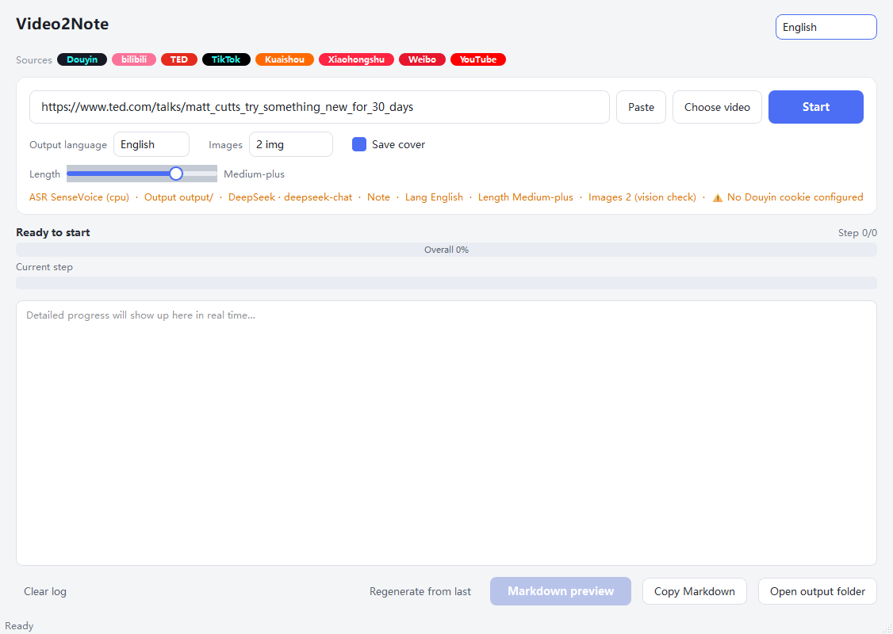
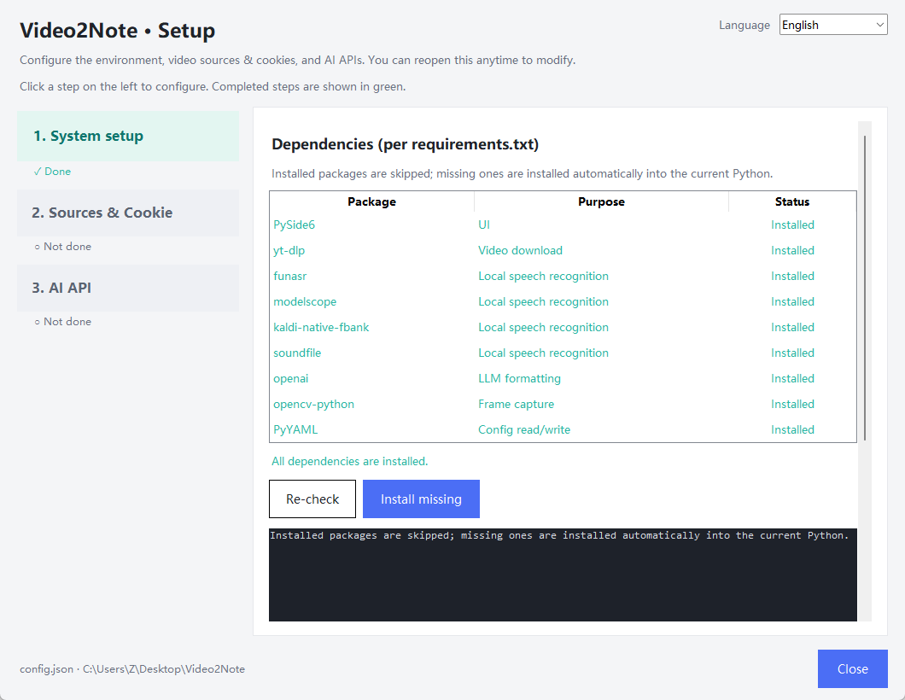
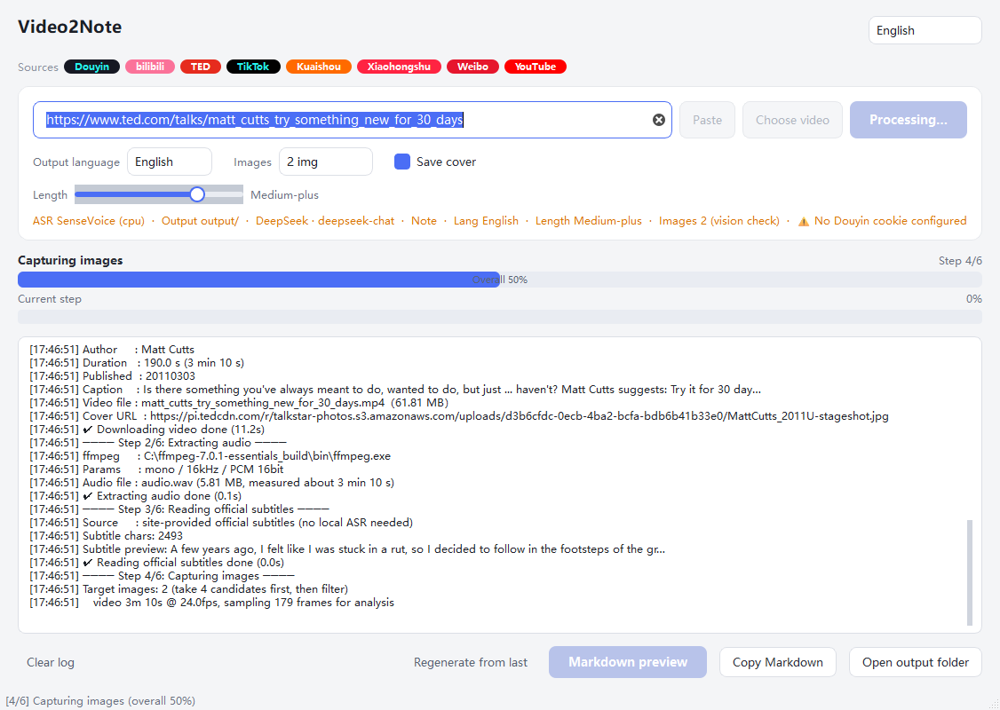
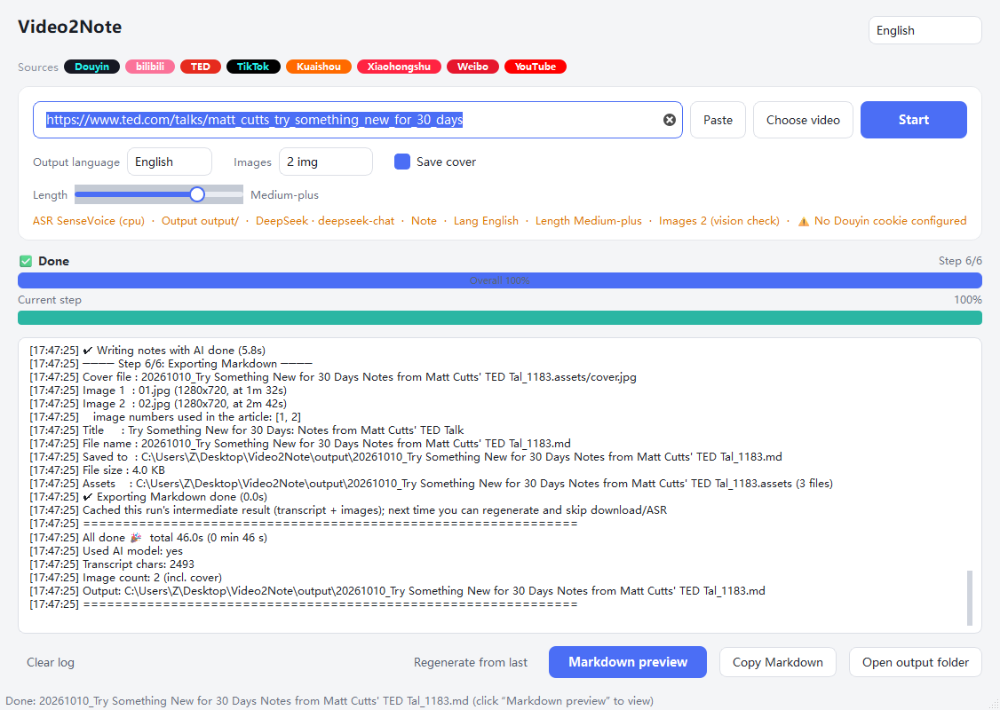
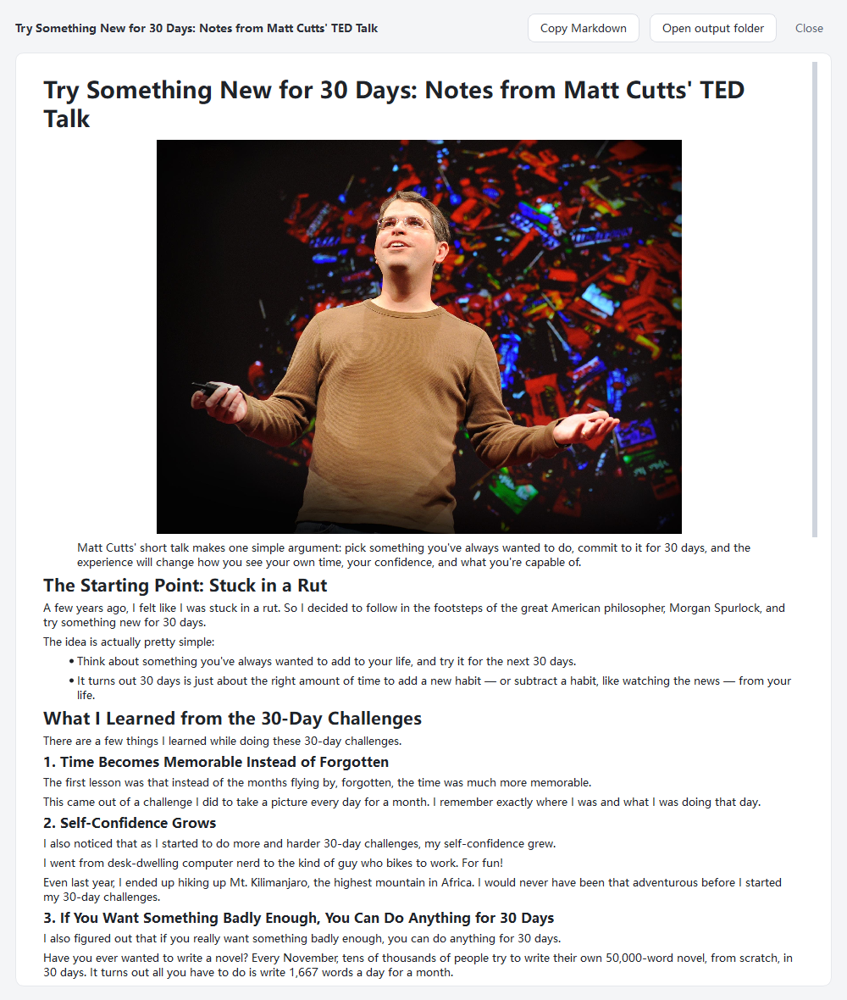

# Video2Note


Video2Note turns a video link into a Markdown note. You paste a link, the app downloads the video,
transcribes the audio on your own machine, asks an AI model to rewrite the transcript into a
structured note, and saves it as a `.md` file. Screenshots can be added along the way.

It works with Douyin, TikTok, Bilibili, Kuaishou, Xiaohongshu, Weibo, YouTube and TED. The speech
recognition runs locally and offline, so it needs no GPU and no paid service. Only the text
rewriting step talks to an AI API, and you can skip that step if you want.



## What it does

- **Takes a link or a whole share message.** Paste a plain URL or the entire "share" text copied
  from an app. The URL is extracted for you.
- **Transcribes locally.** Speech recognition uses FunASR SenseVoice. The model is downloaded once
  (about 1 GB) and then works offline. Chinese accuracy is good and no GPU is required.
- **Writes a note in the language you pick.** The transcript is translated into your chosen output
  language, with 8 options.
- **Adds screenshots.** Key frames are picked from the video (blurry and repeated frames are
  dropped), optionally checked by a vision model, and placed in the note. The video cover can be
  saved as a separate cover image.
- **Switches between AI providers automatically.** DeepSeek is the default, but you can list several
  OpenAI compatible providers. If one fails, the next one is tried.
- **Handles TED talks quickly.** Official subtitles are used directly, so speech recognition is
  skipped.
- **Works with local files.** Pick a video already on your disk, or drag it in, to skip the download.
- **Previews and exports.** A preview window renders the Markdown with its images, and one click
  copies the text or opens the output folder.
- **Speaks 8 interface languages.** English, 简体中文, 日本語, 한국어, Español, Français, Deutsch and
  Русский. The run log is translated too, so an English interface shows English log lines.
- **Can regenerate from the last run.** The previous transcript and images are cached, so you can
  rewrite the note with different settings without downloading or transcribing again.

## A full run, step by step

Below is a real run that turns a TED talk into an English note.

The talk is "Try something new for 30 days" by Matt Cutts (3 min 10 s):
<https://www.ted.com/talks/matt_cutts_try_something_new_for_30_days>

### 0. First launch: the setup wizard

On the very first launch, double click **`setup.bat`**. It opens a small setup wizard with three
steps. Each step you finish turns green, and you can reopen the wizard any time to change anything.



The three steps:

| Step | What it covers |
| --- | --- |
| **1. System setup** | Checks the packages listed in `requirements.txt` and installs whatever is missing in one click. It also lets you set the output folder, the ffmpeg path, the ASR model and device, and the image options. |
| **2. Sources and Cookie** | Tick the video sources you actually need. Douyin and TikTok require a login cookie; the rest do not. Paste the cookie here. |
| **3. AI API** | Add one or more OpenAI compatible providers. DeepSeek is marked Recommended, and providers that can read images are marked Vision. |

### 1. Paste the link

Open **`run.bat`**, paste the link (or the whole share text), and click **Start**.


The supported sources are listed at the top. In the input row you can choose the output language,
how many images to insert, whether to save the cover, and how long the note should be.

### 2. Watch the progress

There are two progress bars. The top one tracks the overall pipeline, and the bottom one tracks the
current step. The log panel on the right prints the details: file sizes, audio duration, transcript
length, token usage, and the final output path.



For this TED talk the pipeline is:

`Downloading video -> Extracting audio -> Reading official subtitles -> Capturing images -> Writing notes with AI -> Exporting Markdown`

TED provides official subtitles, so the speech recognition step is skipped.

### 3. Done

When the run finishes, the status bar shows the generated file and the **Markdown preview** button
becomes active.



### 4. Preview the note

Click **Markdown preview** to open the rendered note. It opens in its own window on the right half of
the screen, full height, with the images visible.



That run produced an English note with several sections, the talk cover, and two screenshots from the
video. The generated file is here: **[docs/example/sample-note.md](docs/example/sample-note.md)**.

## Requirements

- **Windows 10 or 11.** The app is built and tested on Windows.
- **Python 3.10 or newer** from [python.org](https://www.python.org/downloads/). Tick
  "Add python.exe to PATH" during install.
- **ffmpeg** on your `PATH`, or set its path in the setup wizard. A full build is needed, since the
  app needs audio decoders. Trimmed builds without AAC or PCM support are skipped automatically.
- **An internet connection** for downloading videos and calling the AI API. Speech recognition runs
  offline once the model has been downloaded.

## Installation

1. Download or clone this repository and unzip it.
2. Check that `python` and `ffmpeg` are available in a terminal:
   ```bat
   python --version
   ffmpeg -version
   ```
3. Double click **`setup.bat`**. In step 1, click **Install missing** to install the packages from
   `requirements.txt`. This can take a while the first time because FunASR and its dependencies are
   large.

   > If `funasr` fails with `BackendUnavailable: Cannot import 'setuptools.build_meta'`, the wizard
   > retries with `--no-build-isolation` on its own.

4. Continue to steps 2 and 3 to set up your sources, cookie, and AI API key.
5. Double click **`run.bat`** to start the app.

> The scripts use the `python` found on your `PATH`. If you have more than one Python installation,
> make sure the packages go into the same interpreter that runs the app. The wizard installs into the
> interpreter that launched it.

## Configuration

Everything lives in `config.json`, created next to the app. You do not edit it by hand. All changes
go through the setup wizard (`setup.bat`), which can be reopened at any time. Secrets stay on your
machine, and `config.json` is listed in `.gitignore`.

### Step 2, Sources and Cookie

- **Cookie required:** Douyin and TikTok. These need a login cookie to work reliably. Sign in on the
  website, copy the `Cookie` request header (`k=v; k=v; ...`), and paste it into the wizard. You can
  also read cookies from a browser, or point to a Netscape `cookies.txt`.
- **Cookie optional:** Bilibili, Kuaishou, Xiaohongshu, Weibo, YouTube and TED. Public videos work
  without a cookie.

### Step 3, AI API

Add one or more providers. They are tried in order, so the first is the primary and the rest are
fallbacks. Each entry has an API key, an endpoint, a model, and, if the provider supports it, a
vision model.

## Usage

1. Launch with **`run.bat`**.
2. Paste a video link or a whole share message into the box, or click **Choose video** and pick a
   local file, or drop a file onto the window.
3. Set the output options:
   - **Output language.** The language of the final note. The transcript is translated into it.
   - **Images.** How many screenshots to insert. Choose "No images" to turn them off.
   - **Save cover.** Save the video cover as `cover.jpg`. This is separate and does not count toward
     the image limit.
   - **Length.** From Minimal to Detailed.
4. Click **Start** and follow the progress bars and the log.
5. When it finishes, click **Markdown preview** to read the note, or **Open output folder** to find
   the `.md` file.

You can change the interface language from the selector in the top right corner at any time.

## Output format

Each run writes a Markdown file and an assets folder into the output directory:

```
20261010_Try Something New for 30 Days_1183.md
20261010_Try Something New for 30 Days_1183.assets/
    cover.jpg
    01.jpg
    02.jpg
```

The `.md` file starts with YAML front matter (`title`, `source`, `author`, `url`, `duration_seconds`,
`cover`, `created`) followed by the note itself. See the [example note](docs/example/sample-note.md).

Intermediate results (the transcript and images) are cached in `output/.last_run_cache/`. This is
what powers **Regenerate from last**.

## Supported video sources

| Source | Cookie | Notes |
| --- | --- | --- |
| Douyin (抖音) | required | Native parser, no watermark. yt-dlp is used only as a fallback. |
| TikTok | required | Most content needs a login cookie. |
| Bilibili (哔哩哔哩) | optional | Public videos need no cookie. |
| Kuaishou (快手) | optional | Public videos need no cookie. |
| Xiaohongshu (小红书) | optional | Some content needs login. |
| Weibo (微博) | optional | Public videos need no cookie. |
| YouTube | optional | Prefers native subtitles when available. |
| TED | optional | Fetches official subtitles and skips speech recognition. |

Any other site that `yt-dlp` can parse also works.

## Supported AI providers

All providers are OpenAI compatible, which means a `base_url`, an `api_key`, and a `model`. Providers
with a vision model can also check the screenshots used as images.

| Provider | Endpoint | Vision |
| --- | --- | --- |
| **DeepSeek** (recommended) | `https://api.deepseek.com` | yes |
| OpenAI | `https://api.openai.com/v1` | yes |
| Kimi (Moonshot) | `https://api.moonshot.cn/v1` | yes |
| 智谱 AI (GLM) | `https://open.bigmodel.cn/api/paas/v4` | yes |
| 通义千问 DashScope | `https://dashscope.aliyuncs.com/compatible-mode/v1` | yes |
| 火山方舟 Volcengine (Doubao) | `https://ark.cn-beijing.volces.com/api/v3` | yes |
| SiliconFlow | `https://api.siliconflow.cn/v1` | yes |
| OpenRouter | `https://openrouter.ai/api/v1` | yes |
| Groq | `https://api.groq.com/openai/v1` | yes |
| Baidu Qianfan | `https://qianfan.baidubce.com/v2` | yes |

You can also add a custom provider with any OpenAI compatible endpoint.

## FAQ and troubleshooting

**Do I need a cookie?**
Only for Douyin and TikTok. Everything else, including Bilibili, YouTube and TED, works with public
videos and no cookie.

**It says Douyin needs a login, or the cookie expired.**
Cookies expire after a few days or weeks. Sign in on the website again, copy the fresh `Cookie`
header, and paste it into step 2 of the setup wizard. The wizard warns you if a cookie is already
configured and asks whether you want to replace it.

**It says funasr or modelscope is missing at step 3.**
The dependencies went into a different Python than the one running the app. Double click `setup.bat`
and click **Install missing**. That installs into the correct interpreter.

**It says no usable ffmpeg was found.**
The first `ffmpeg` on your `PATH` may be a trimmed build without audio decoders. Install a full
ffmpeg build, or set the path to `ffmpeg.exe` in step 1 of the setup wizard.

**Why are there two AI calls?**
The first call proofreads and segments the transcript, and the second writes the note. Cleaning up
the transcript first improves the result noticeably and costs very little.

**Does the log follow the interface language?**
Yes. The run log is translated along with the rest of the interface, so switching to English shows
English log lines. The only exceptions are text that comes back from the AI model, such as an image
caption, and the names of proper nouns.

## Project structure

```
Video2Note/
├── app/
│   ├── main.py              # entry point (python -m app.main)
│   ├── prompts.py           # AI prompts
│   ├── core/
│   │   ├── config.py        # config read/write, plus the source and provider catalogs
│   │   ├── deps.py          # dependency list and checks
│   │   ├── downloader.py    # native Douyin and TED parsing, yt-dlp fallback, audio extraction
│   │   ├── asr.py           # FunASR SenseVoice speech recognition
│   │   ├── frames.py        # smart frame extraction for images
│   │   ├── llm.py           # multi-provider client with fallback, plus vision
│   │   ├── cache.py         # last-run cache, used by "Regenerate from last"
│   │   └── pipeline.py      # the whole pipeline
│   └── ui/
│       ├── main_window.py   # main window
│       ├── preview_window.py# Markdown preview window
│       ├── i18n.py          # interface translations, including the run log
│       └── style.py         # stylesheet
├── setup_ui.py              # the setup wizard (native tkinter)
├── check_deps.py            # dependency self-check, used by run.bat
├── setup.bat                # open the setup wizard
├── run.bat                  # launch the app
├── requirements.txt
├── config.example.json
└── docs/                    # screenshots and example output
```

## License

Released under the MIT License. See [LICENSE](LICENSE).

This project is meant for personal use with content you are allowed to access. Please respect the
terms of service and the copyright of the platforms and creators you download from. How you use it
is up to you.
