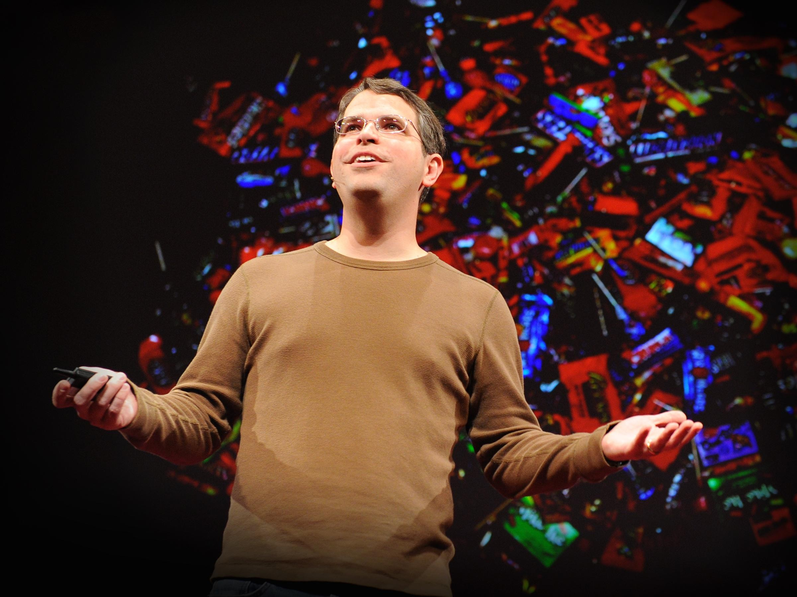
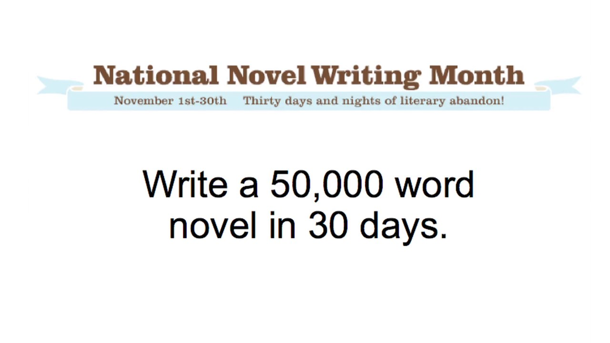
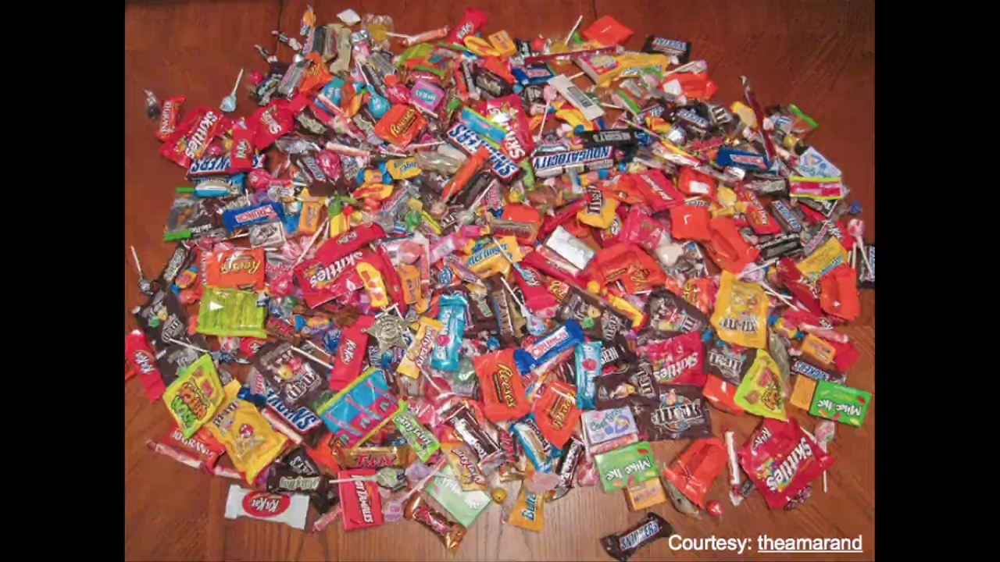

# Try Something New for 30 Days: Notes from Matt Cutts' TED Talk

> Matt Cutts' short talk makes one simple argument: pick something you've always wanted to do, commit to it for 30 days, and the experience will change how you see your own time, your confidence, and what you're capable of.

## The Starting Point: Stuck in a Rut

A few years ago, I felt like I was stuck in a rut. So I decided to follow in the footsteps of the great American philosopher, Morgan Spurlock, and try something new for 30 days.

The idea is actually pretty simple:

- Think about something you've always wanted to add to your life, and try it for the next 30 days.
- It turns out 30 days is just about the right amount of time to add a new habit — or subtract a habit, like watching the news — from your life.

## What I Learned from the 30-Day Challenges

There are a few things I learned while doing these 30-day challenges.

### 1. Time Becomes Memorable Instead of Forgotten

The first lesson was that instead of the months flying by, forgotten, the time was much more memorable.

This came out of a challenge I did to take a picture every day for a month. I remember exactly where I was and what I was doing that day.

### 2. Self-Confidence Grows

I also noticed that as I started to do more and harder 30-day challenges, my self-confidence grew.

I went from desk-dwelling computer nerd to the kind of guy who bikes to work. For fun!

Even last year, I ended up hiking up Mt. Kilimanjaro, the highest mountain in Africa. I would never have been that adventurous before I started my 30-day challenges.

### 3. If You Want Something Badly Enough, You Can Do Anything for 30 Days

I also figured out that if you really want something badly enough, you can do anything for 30 days.

Have you ever wanted to write a novel? Every November, tens of thousands of people try to write their own 50,000-word novel, from scratch, in 30 days. It turns out all you have to do is write 1,667 words a day for a month.

So I did. By the way, the secret is not to go to sleep until you've written your words for the day. You might be sleep-deprived, but you'll finish your novel.

Now, is my book the next great American novel? No. I wrote it in a month. It's awful.

But for the rest of my life, if I meet John Hodgman at a TED party, I don't have to say, "I'm a computer scientist." No, no — if I want to, I can say, "I'm a novelist."

### 4. Small, Sustainable Changes Stick Better

So here's one last thing I'd like to mention. I learned that when I made small, sustainable changes — things I could keep doing — they were more likely to stick.

There's nothing wrong with big, crazy challenges. In fact, they're a ton of fun. But they're less likely to stick.

When I gave up sugar for 30 days, day 31 looked like this.

## My Question to You

So here's my question to you: What are you waiting for?

I guarantee you the next 30 days are going to pass whether you like it or not, so why not think about something you have always wanted to try and give it a shot! For the next 30 days.

Thanks.
